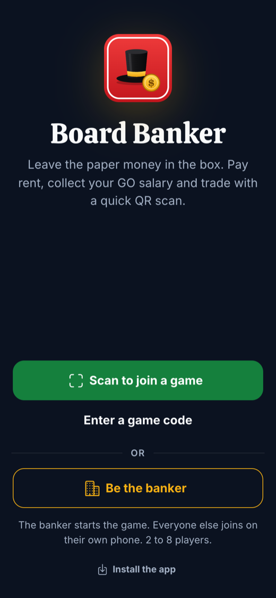
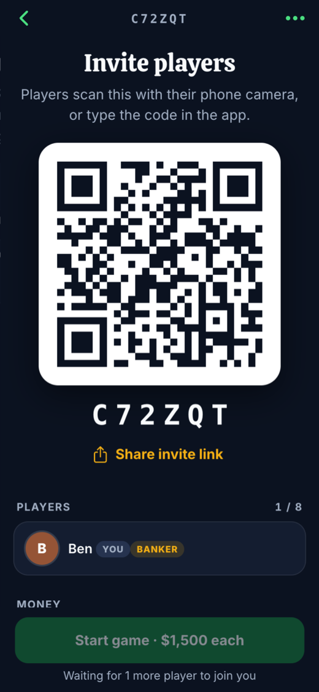
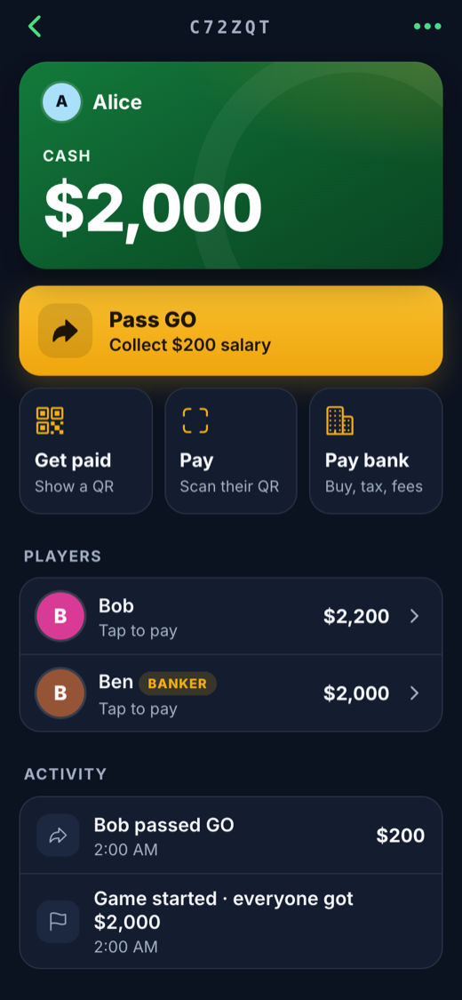
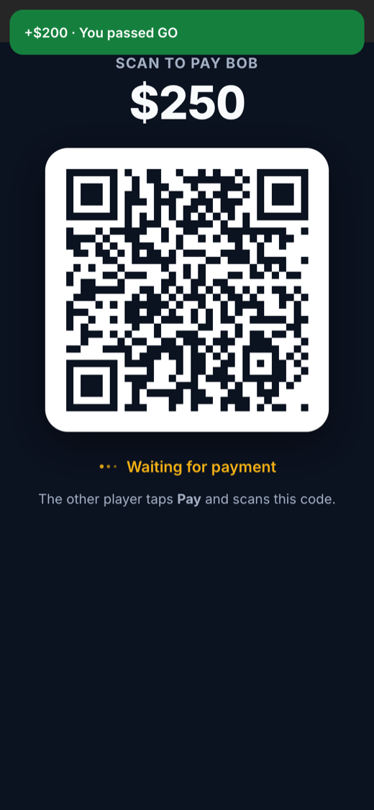
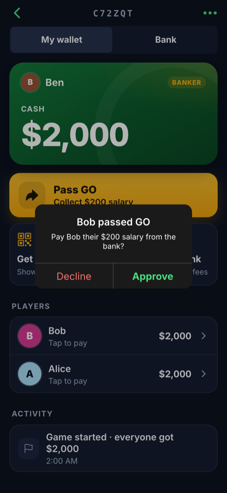
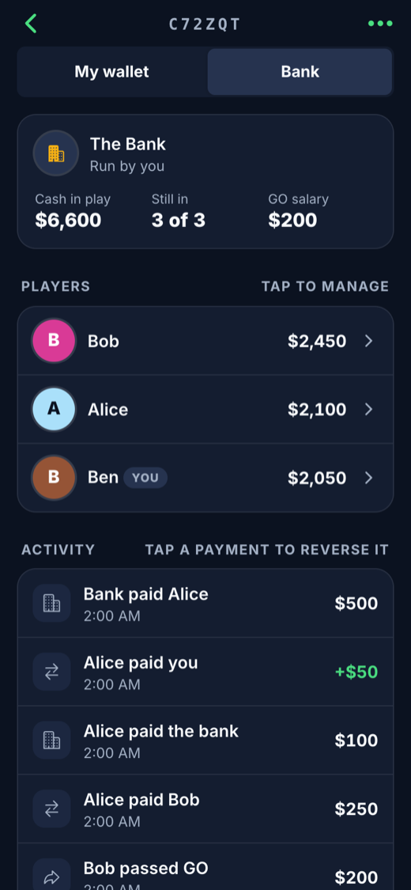

# Board Banker

[](https://ko-fi.com/kavin26)

A phone app (PWA) that replaces the paper money in property-trading board games. The banker starts a game and shows a QR code; 2 to 8 players join with their own phones. Players pay each other by showing and scanning payment QR codes, ask the banker for their GO salary (the banker approves it in a pop-up), and pay the bank. The banker pays out from the bank, corrects balances, reverses mistakes and ends the game.

[](https://board-banker-26.web.app)

There's nothing to install and no sign-up: everyone opens the link on their own phone, and can add it to the home screen to use it like an app. The setup below is only needed to host your own copy.

|  |  |  |
|:-:|:-:|:-:|
| Start or join a game | Players scan to join | Each player's wallet |
|  |  |  |
| Get paid with a single-use QR | The banker approves GO salary | Bank tab and activity log |

Built with Ionic + Angular, Firebase (Firestore + anonymous auth) and Firebase Hosting.

## First-time Firebase setup

1. In the [Firebase console](https://console.firebase.google.com/project/board-banker-26/authentication/providers), open **Authentication → Get started → Sign-in method → Anonymous → Enable**. Players never see a login; this gives each phone a private ID so the database rules can protect balances.
2. Deploy the app and the security rules: `npm run deploy`.

The Firestore database is in `asia-southeast1` (Singapore), close to the players in Malaysia. Every money move is a round trip to it, so the region decides how fast payments feel. Firestore can't move a database to another region; changing it means deleting and recreating the database, which loses its data.

## Develop

```bash
npm install
cp src/app/firebase.config.example.ts src/app/firebase.config.ts   # then fill in your Firebase web app config
npm run dev          # Firebase emulators + ng serve on http://localhost:4200
```

`firebase.config.ts` is gitignored. Set your project ID in `.firebaserc` too (`firebase use <project-id>`).

Development talks to local emulators only (`src/environments/environment.ts`). The camera needs `localhost` or HTTPS, so test scanning on a phone against a deployed build.

## Test

```bash
npm test             # unit tests (money helpers)
npm run test:rules   # Firestore security rules: honest moves pass, cheating is refused
npm run test:e2e     # end-to-end in Chrome; needs `npm run dev` running
```

`test:e2e` simulates several phones, scans QR codes through Chrome's fake camera and writes screenshots to `e2e/screenshots/`. Pass scenario names to run a subset: `npm run test:e2e -- main rm edges pwa`.

## How money is protected

All balances live in Firestore and every change runs in a transaction. `firestore.rules` enforces the game rules on the server:

- A player can only lower their own balance (paying), down to minus the banker's debt limit. A payment past the limit still pays in full and makes the payer bankrupt. Going bankrupt hands over only the cash they have, never debt.
- GO salary is paid by the banker, against the player's request for exactly the salary.
- Raising someone else's balance is only allowed by the exact amount the payer lost in the same write.
- Only the banker pays out of the bank, corrects balances, reverses transactions and ends the game.
- A payment QR is single-use and only counts as paid when the money actually moved.

The 6-character game code is the invite: a game can only be opened by its code, never browsed.

## Data cleanup

Game data expires 7 days after the game is created (`KEEP_DAYS` in `src/app/money.ts`), and expired games are cleared out automatically.
